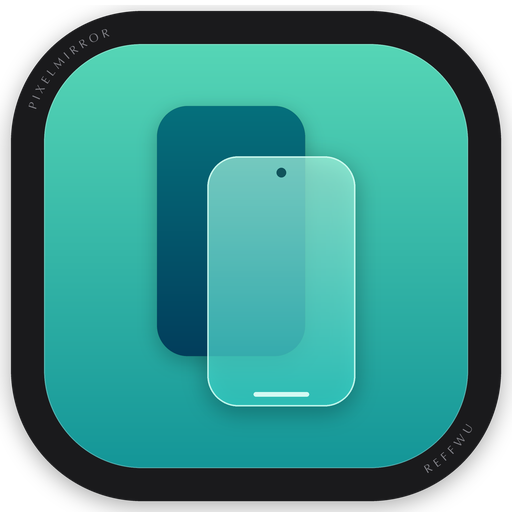
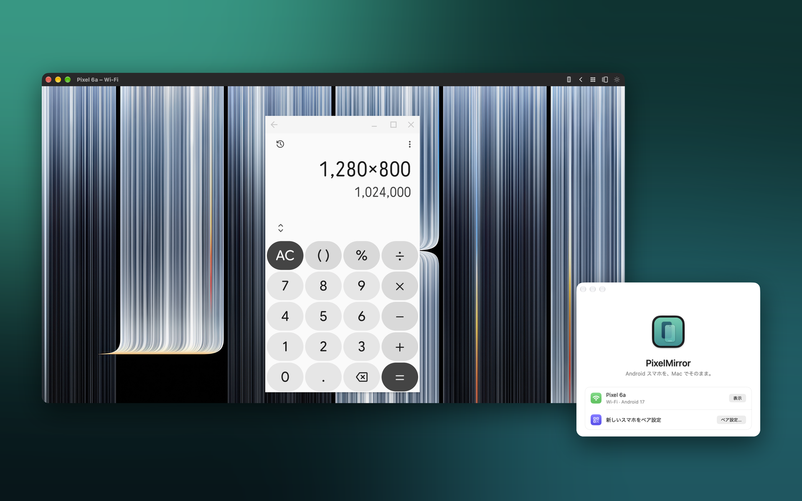

<div align="center">



# PixelMirror

**Android スマホを、Mac でそのまま。**

<a href="https://github.com/ReffWu/pixelmirror/releases/latest/download/PixelMirror.dmg">
  <picture>
    <source media="(prefers-color-scheme: dark)" srcset="docs/readme/download-ja-dark.png">
    
  </picture>
</a>

<sub>無料 · macOS 14 以降 · Apple シリコン · Apple による署名と公証済み</sub>

[English](README.md) · [简体中文](README.zh-CN.md) · [繁體中文](README.zh-TW.md) · 日本語 · [한국어](README.ko.md)

</div>

<p align="center">
  
</p>

---

机の上に伏せたスマホに通知が届く。PixelMirror を開けば、もう画面がウインドウに映っています。トラックパッドでタップし、キーボードで日本語も入力し、片方でコピーしてもう片方でペースト、音は Mac から。ワイヤレス デバッグを一度オンにすれば、次からは自分でスマホを見つけます。ケーブルもターミナルも、スマホへのインストールも要りません。

もっと広く使いたいときは、ウインドウを**コンピュータモード**に切り替えます。スマホが Mac 上に自分のデスクトップを開き、アプリは動かしたりサイズを変えたりできるウインドウに。マウスポインタも右クリックも使えます。

## ダウンロード

[PixelMirror.dmg をダウンロード](https://github.com/ReffWu/pixelmirror/releases/latest/download/PixelMirror.dmg)して開き、PixelMirror を「アプリケーション」へドラッグしてください。Developer ID で署名され、Apple の公証を受けており、自動でアップデートされます。

はじめて使うとき：

1. スマホの **設定 › デバイス情報** で **ビルド番号** を 7 回タップして **開発者向けオプション** を有効にします。
2. **設定 › システム › 開発者向けオプション › ワイヤレス デバッグ** をオンにし、**QR コードによるデバイスのペア設定** をタップして PixelMirror ウインドウの QR コードを読み取ります。
3. これで完了です。以後はワイヤレス デバッグがオンで同じ Wi-Fi にいれば、自動でつながります。USB ケーブルでも使えます。スマホで **許可** をタップしてください。

## 動作環境

Apple シリコン搭載の Mac、macOS 14 以降。Android 11 以降のスマホ（Pixel 以外のメーカーも可）。

## しくみ

PixelMirror は Google の `adb` と scrcpy サーバーを内蔵しています。Bonjour でローカルネットワーク上のワイヤレス デバッグ サービスを見つけ、自分で描いた QR コードでペア設定し、自動で接続します。スマホ側では scrcpy サーバーが H.264 映像と音声を送り、Mac 側では VideoToolbox がネイティブウインドウに映像をデコードし、AVAudioEngine が小さな一定の遅延で音を再生します。クリック、トラックパッドのスクロールとピンチ、キー入力と文字はタッチとキーイベントとしてスマホへ戻ります。データはネットワークの外に出ません。

## 言語

英語、簡体字中国語、繁体字中国語、日本語、韓国語、ドイツ語、フランス語、スペイン語、イタリア語、ブラジルポルトガル語、ロシア語、オランダ語、トルコ語、ポーランド語、アラビア語、ベトナム語に対応しています。Mac の言語設定に従うほか、PixelMirror のウインドウで個別に選べます。

## ソースからビルド

```sh
git clone https://github.com/ReffWu/pixelmirror.git
cd pixelmirror
make build
open build/PixelMirror.app
```

## コントリビュート

アイデア、バグ報告、プルリクエストを歓迎します。[Issue を作成](https://github.com/ReffWu/pixelmirror/issues)するか、PR を送ってください。

## クレジット

PixelMirror は Genymobile の [scrcpy](https://github.com/Genymobile/scrcpy)（Apache 2.0、サーバーはスマホ上で動作）と Google の [Android SDK Platform-Tools](https://developer.android.com/tools/releases/platform-tools)（`adb`）の上に成り立っています。どちらも無改変で同梱し、ライセンスはアプリ内に含まれています。

## ライセンス

[MIT](LICENSE)
