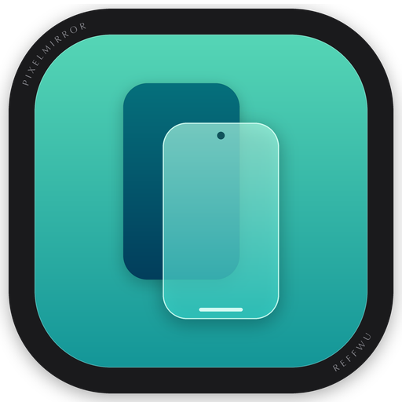
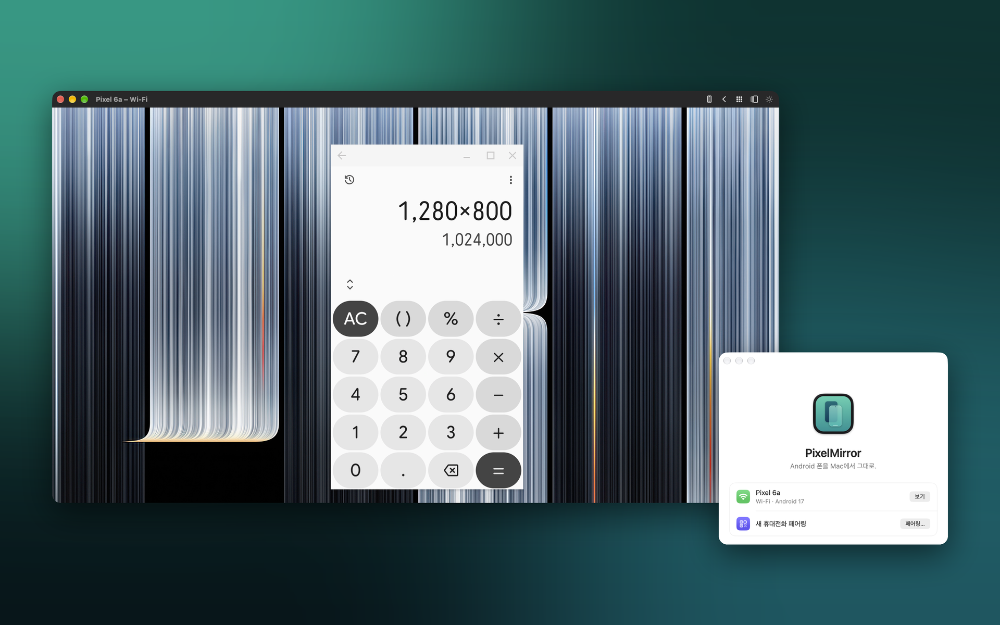

<div align="center">



# PixelMirror

**Android 폰을 Mac에서 그대로.**

<a href="https://github.com/ReffWu/pixelmirror/releases/latest/download/PixelMirror.dmg">
  <picture>
    <source media="(prefers-color-scheme: dark)" srcset="docs/readme/download-ko-dark.png">
    
  </picture>
</a>

<sub>무료 · macOS 14 이상 · Apple 실리콘 · Apple 서명 및 공증 완료</sub>

[English](README.md) · [简体中文](README.zh-CN.md) · [繁體中文](README.zh-TW.md) · [日本語](README.ja.md) · 한국어

</div>

<p align="center">
  
</p>

---

책상 위에 엎어 둔 폰에 알림이 옵니다. PixelMirror를 열면 폰 화면이 이미 창 안에 있습니다. 트랙패드로 탭하고, 키보드로 한글도 입력하고, 한쪽에서 복사해 다른 쪽에 붙여 넣고, 소리는 Mac에서 들립니다. 무선 디버깅을 한 번만 켜 두면 그다음부터는 알아서 폰을 찾습니다. 케이블도, 터미널도, 폰에 설치할 것도 없습니다.

더 넓게 쓰고 싶다면 창을 **컴퓨터 모드**로 바꾸세요. 폰이 Mac 위에 자신만의 데스크톱을 열고, 앱은 옮기고 크기를 바꿀 수 있는 창에서 열리며, 마우스 포인터와 오른쪽 클릭도 됩니다.

## 다운로드

[PixelMirror.dmg 다운로드](https://github.com/ReffWu/pixelmirror/releases/latest/download/PixelMirror.dmg) 후 열어서 PixelMirror를 응용 프로그램 폴더로 드래그하세요. Developer ID로 서명되고 Apple의 공증을 받았으며, 자동으로 최신 상태를 유지합니다.

처음 사용할 때:

1. 폰의 **설정 › 휴대전화 정보**에서 **빌드 번호**를 7번 탭해 **개발자 옵션**을 켭니다.
2. **설정 › 시스템 › 개발자 옵션 › 무선 디버깅**을 켜고 **QR 코드로 기기 페어링**을 탭한 뒤 PixelMirror 창의 QR 코드를 스캔합니다.
3. 끝입니다. 이후에는 무선 디버깅이 켜져 있고 같은 Wi-Fi에 있으면 자동으로 연결됩니다. USB 케이블도 됩니다. 폰에서 **허용**을 탭하세요.

## 요구 사항

Apple 실리콘 Mac, macOS 14 이상. Android 11 이상 폰(Pixel 외 다른 제조사도 가능).

## 작동 방식

PixelMirror는 Google의 `adb`와 scrcpy 서버를 내장하고 있습니다. Bonjour로 로컬 네트워크에서 폰의 무선 디버깅 서비스를 찾고, 직접 그린 QR 코드로 페어링한 뒤 자동으로 연결합니다. 폰에서는 scrcpy 서버가 H.264 영상과 원본 오디오를 보내고, Mac에서는 VideoToolbox가 네이티브 창에 영상을 디코딩하며 AVAudioEngine이 작고 일정한 지연으로 소리를 재생합니다. 클릭, 트랙패드 스크롤과 핀치, 키와 텍스트는 터치·키 이벤트로 폰에 전달됩니다. 데이터는 네트워크 밖으로 나가지 않습니다.

## 언어

영어, 중국어 간체, 중국어 번체, 일본어, 한국어, 독일어, 프랑스어, 스페인어, 이탈리아어, 브라질 포르투갈어, 러시아어, 네덜란드어, 튀르키예어, 폴란드어, 아랍어, 베트남어를 지원합니다. Mac의 언어 설정을 따르며, PixelMirror 창에서 따로 고를 수도 있습니다.

## 소스에서 빌드

```sh
git clone https://github.com/ReffWu/pixelmirror.git
cd pixelmirror
make build
open build/PixelMirror.app
```

## 기여하기

아이디어, 버그 제보, 풀 리퀘스트 모두 환영합니다. [이슈를 열거나](https://github.com/ReffWu/pixelmirror/issues) PR을 보내 주세요.

## 크레딧

PixelMirror는 Genymobile의 [scrcpy](https://github.com/Genymobile/scrcpy)(Apache 2.0, 서버는 폰에서 실행)와 Google의 [Android SDK Platform-Tools](https://developer.android.com/tools/releases/platform-tools)(`adb`) 위에 만들어졌습니다. 이 브랜치는 scrcpy가 한 개의 물리 디스플레이만 제어하도록 화면 전원 동작을 수정합니다. 라이선스는 앱 안에 들어 있습니다.

## 라이선스

[MIT](LICENSE)
