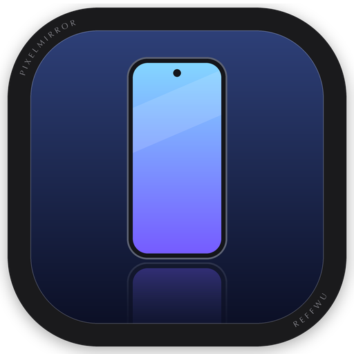

<div align="center">



# PixelMirror

**Your Android phone, live on your Mac.**

English · [简体中文](README.zh-CN.md) · [繁體中文](README.zh-TW.md) · [日本語](README.ja.md) · [한국어](README.ko.md)

[](#requirements)
[](#requirements)
[](LICENSE)

</div>

---

Your phone is face down on the desk and something just arrived. Open PixelMirror and the phone is already there in a window: tap with the trackpad, type with your keyboard in any language, copy on one side and paste on the other, hear its sound through your Mac. Turn on Wireless debugging once and it finds your phone by itself every time after, no cable, no Terminal, nothing to install on the phone.

## Download

[Download PixelMirror.dmg](https://github.com/ReffWu/pixelmirror/releases/latest/download/PixelMirror.dmg), open it and drag PixelMirror into Applications. The app is signed with a Developer ID and notarized by Apple, and it keeps itself up to date.

First time:

1. On the phone, tap **Build number** 7 times in **Settings › About phone** to unlock **Developer options**.
2. Open **Settings › System › Developer options › Wireless debugging**, turn it on, tap **Pair device with QR code** and scan the code in the PixelMirror window.
3. That's it. From now on, whenever Wireless debugging is on and both are on the same Wi-Fi, the phone shows up on its own. A USB cable works too: tap **Allow** on the phone.

## Requirements

macOS 14 or later on Apple silicon, and an Android 11 or later phone (Pixel or any other brand).

## How it works

PixelMirror carries its own copy of Google's `adb` and the scrcpy server. It watches the local network for the phone's Wireless debugging service over Bonjour, pairs with the QR code it draws, and connects on its own. On the phone, the scrcpy server streams H.264 video and raw audio; on the Mac, VideoToolbox decodes the video into a native window and AVAudioEngine plays the sound with a small fixed delay. Clicks, trackpad scrolls and pinches, keys and text go back as touch and key events. Nothing leaves your network.

## Languages

English, Simplified Chinese, Traditional Chinese, Japanese, Korean, German, French, Spanish, Italian, Brazilian Portuguese, Russian, Dutch, Turkish, Polish, Arabic and Vietnamese. PixelMirror follows your Mac's language, or pick one in the PixelMirror window.

## Build from source

```sh
git clone https://github.com/ReffWu/pixelmirror.git
cd pixelmirror
make build
open build/PixelMirror.app
```

## Contributing

Ideas, bug reports and pull requests are welcome. [Open an issue](https://github.com/ReffWu/pixelmirror/issues) or send a PR.

## Credits

PixelMirror stands on [scrcpy](https://github.com/Genymobile/scrcpy) by Genymobile (Apache 2.0), whose server runs on the phone, and Google's [Android SDK Platform-Tools](https://developer.android.com/tools/releases/platform-tools) (`adb`). Both are bundled unmodified; their licenses ship inside the app.

## License

[MIT](LICENSE)
