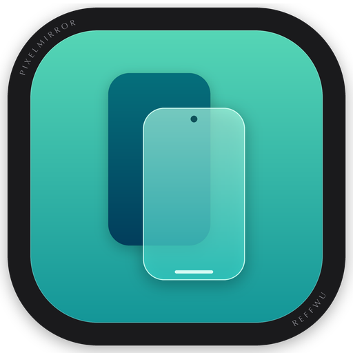
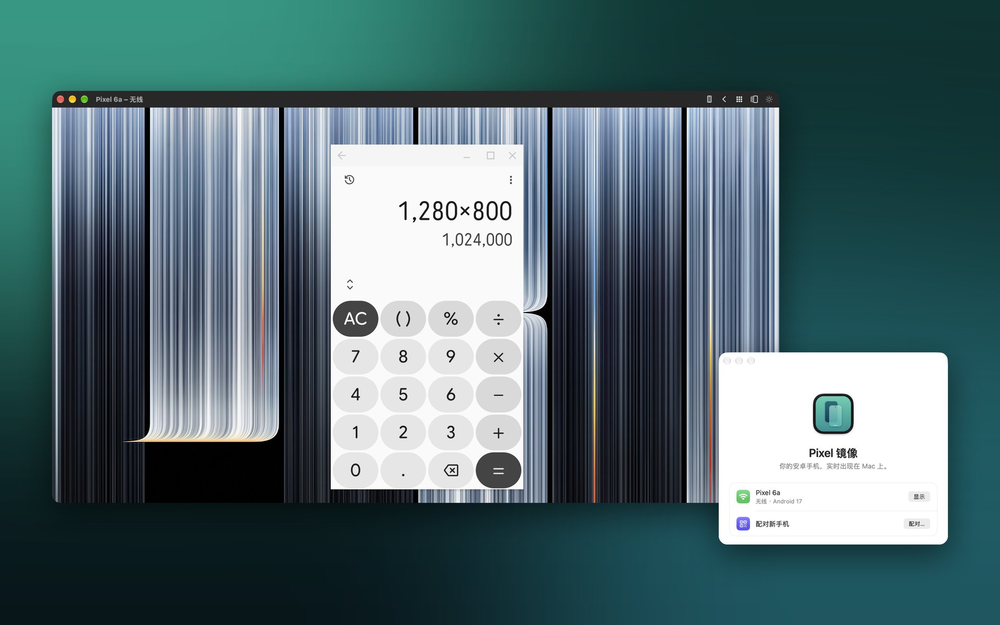

<div align="center">



# PixelMirror

**你的安卓手机，实时出现在 Mac 上。**

<a href="https://github.com/ReffWu/pixelmirror/releases/latest/download/PixelMirror.dmg">
  <picture>
    <source media="(prefers-color-scheme: dark)" srcset="docs/readme/download-zh-Hans-dark.png">
    
  </picture>
</a>

<sub>免费 · macOS 14 或更新版本 · Apple 芯片 · 经 Apple 签名与公证</sub>

[English](README.md) · 简体中文 · [繁體中文](README.zh-TW.md) · [日本語](README.ja.md) · [한국어](README.ko.md)

</div>

<p align="center">
  
</p>

---

手机扣在桌上，来了条消息。打开 Pixel 镜像，手机画面已经在窗口里：用触控板点、用键盘打字（中文输入法也行）、这边复制那边粘贴、声音从 Mac 里出来。无线调试只要开一次，之后每次都会自己找到手机，不用数据线，不用终端，手机上也不用装任何东西。

想要更大的空间？把窗口切到**电脑模式**，手机会在 Mac 上开出一个自己的桌面：App 在能拖动、能缩放的窗口里，有鼠标指针，也能右键。

## 下载

[下载 PixelMirror.dmg](https://github.com/ReffWu/pixelmirror/releases/latest/download/PixelMirror.dmg)，打开后把 PixelMirror 拖进「应用程序」。App 使用 Developer ID 签名并经过 Apple 公证，会自动保持最新。

第一次使用：

1. 在手机的 **设置 › 关于手机** 里连续点 7 次 **版本号**，打开 **开发者选项**。
2. 进入 **设置 › 系统 › 开发者选项 › 无线调试**，打开它，点 **使用二维码配对设备**，扫描 Pixel 镜像窗口里的二维码。
3. 完成。以后只要无线调试开着、手机和 Mac 在同一个 Wi-Fi，就会自动连上。也可以插 USB 线，在手机上点 **允许**。

## 系统要求

搭载 Apple 芯片的 Mac，macOS 14 或更新版本；Android 11 或更新版本的手机（Pixel 或其他品牌都可以）。

## 工作原理

Pixel 镜像自带 Google 的 `adb` 和 scrcpy 服务端。它通过 Bonjour 在局域网里监听手机的无线调试服务，用自己生成的二维码完成配对，然后自动连接。手机端由 scrcpy 服务端推送 H.264 视频和原始音频；Mac 端用 VideoToolbox 解码成原生窗口，用 AVAudioEngine 以很小的固定延迟播放声音。点击、触控板滚动和捏合、按键与文字会作为触摸和按键事件传回手机。所有数据都不出你的局域网。

## 语言

支持英语、简体中文、繁体中文、日语、韩语、德语、法语、西班牙语、意大利语、巴西葡萄牙语、俄语、荷兰语、土耳其语、波兰语、阿拉伯语和越南语。默认跟随系统语言，也可以在 PixelMirror 窗口里单独选择。

## 从源码构建

编译 Android 服务端需要 JDK、Android SDK Platform 36 和 Build-Tools 36.0.0。将 `ANDROID_HOME` 指向 SDK 目录。

```sh
git clone https://github.com/ReffWu/pixelmirror.git
cd pixelmirror
make build
open build/PixelMirror.app
```

## 参与贡献

欢迎提想法、报 Bug、发 Pull Request。可以[提交 Issue](https://github.com/ReffWu/pixelmirror/issues) 或直接发 PR。

## 致谢

Pixel 镜像建立在 Genymobile 的 [scrcpy](https://github.com/Genymobile/scrcpy)（Apache 2.0，其服务端运行在手机上）和 Google 的 [Android SDK Platform-Tools](https://developer.android.com/tools/releases/platform-tools)（`adb`）之上。此分支为 scrcpy 增加了单块实体屏的电源控制。许可证随 App 一起分发。

## 许可证

[MIT](LICENSE)
