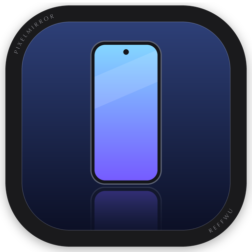

<div align="center">



# PixelMirror

**你的 Android 手機，即時出現在 Mac 上。**

[English](README.md) · [简体中文](README.zh-CN.md) · 繁體中文 · [日本語](README.ja.md) · [한국어](README.ko.md)

[](#系統需求)
[](#系統需求)
[](LICENSE)

</div>

---

手機蓋在桌上，來了則訊息。打開 Pixel 鏡像，手機畫面已經在視窗裡：用觸控板點、用鍵盤打字（中文輸入法也行）、這邊複製那邊貼上、聲音從 Mac 裡出來。無線偵錯只要開一次，之後每次都會自己找到手機，不用傳輸線，不用終端機，手機上也不用裝任何東西。

## 下載

[下載 PixelMirror.dmg](https://github.com/ReffWu/pixelmirror/releases/latest/download/PixelMirror.dmg)，打開後把 PixelMirror 拖進「應用程式」。App 使用 Developer ID 簽署並經過 Apple 公證，會自動保持最新。

第一次使用：

1. 在手機的 **設定 › 關於手機** 裡連續點 7 次 **版本號碼**，開啟 **開發人員選項**。
2. 進入 **設定 › 系統 › 開發人員選項 › 無線偵錯**，開啟後點 **使用 QR 圖碼配對裝置**，掃描 Pixel 鏡像視窗裡的 QR 圖碼。
3. 完成。之後只要無線偵錯開著、手機和 Mac 在同一個 Wi-Fi，就會自動連上。也可以插 USB 線，在手機上點 **允許**。

## 系統需求

搭載 Apple 晶片的 Mac，macOS 14 或更新版本；Android 11 或更新版本的手機（Pixel 或其他品牌都可以）。

## 運作原理

Pixel 鏡像內建 Google 的 `adb` 與 scrcpy 伺服器。它透過 Bonjour 在區域網路中監聽手機的無線偵錯服務，用自己產生的 QR 圖碼完成配對，然後自動連線。手機端由 scrcpy 伺服器傳送 H.264 影像與原始音訊；Mac 端用 VideoToolbox 解碼成原生視窗，用 AVAudioEngine 以很小的固定延遲播放聲音。點按、觸控板捲動與縮放、按鍵與文字會以觸控與按鍵事件傳回手機。所有資料都不會離開你的區域網路。

## 語言

支援英文、簡體中文、繁體中文、日文、韓文、德文、法文、西班牙文、義大利文、巴西葡萄牙文、俄文、荷蘭文、土耳其文、波蘭文、阿拉伯文和越南文。預設跟隨系統語言，也可以在 PixelMirror 視窗裡另外選擇。

## 從原始碼建置

```sh
git clone https://github.com/ReffWu/pixelmirror.git
cd pixelmirror
make build
open build/PixelMirror.app
```

## 參與貢獻

歡迎提供想法、回報 Bug、送出 Pull Request。可以[建立 Issue](https://github.com/ReffWu/pixelmirror/issues) 或直接送 PR。

## 致謝

Pixel 鏡像建立在 Genymobile 的 [scrcpy](https://github.com/Genymobile/scrcpy)（Apache 2.0，其伺服器執行於手機上）與 Google 的 [Android SDK Platform-Tools](https://developer.android.com/tools/releases/platform-tools)（`adb`）之上。兩者皆未經修改直接打包，授權條款隨 App 一併提供。

## 授權

[MIT](LICENSE)
